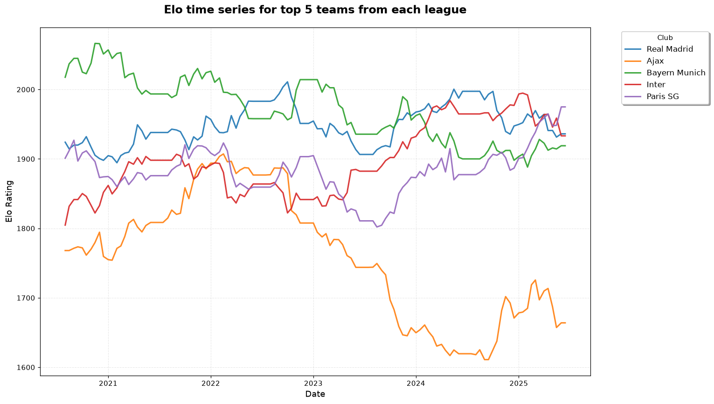
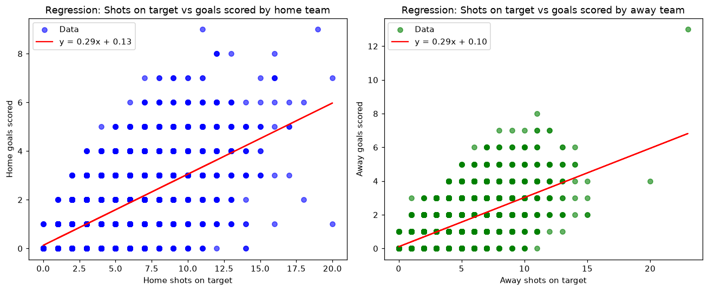

# Football Analytics


Hurtownia danych o meczach piłkarskich z pięciu czołowych lig europejskich, zasilana procesem ETL z surowych plików CSV do bazy MySQL, wraz z analizą statystyczną załadowanych danych.

## Podgląd

Wykresy wygenerowane z danych w hurtowni (8 621 meczów z sezonów 2020/21–2024/25).



| Rozkład rankingu Elo według lig | Strzały celne a gole |
|---|---|
|  |  |

## Zbiór danych

Projekt korzysta ze zbioru **[Club Football Match Data (2000–2025)](https://www.kaggle.com/datasets/adamgbor/club-football-match-data-2000-2025)** autorstwa Adama Gábora (licencja MIT). Do hurtowni trafiają mecze z lig I1 (Serie A), SP1 (La Liga), D1 (Bundesliga), F1 (Ligue 1) i N1 (Eredivisie) rozegrane od 1 sierpnia 2020 do 30 czerwca 2025.

## Proces ETL

1. **Extract** — wczytanie plików CSV do tabel `raw_eloRatings` i `raw_Matches`.
2. **Clean** — konwersja typów i uzupełnienie brakujących lub błędnych wartości.
3. **Load** — załadowanie 5 tabel wymiarów i tabeli faktów `fact_matches` w schemacie gwiazdy.
4. **Export** — zapis danych surowych do `backend/csv/raw/` i wymiarów do `backend/csv/clean/`.

| Tabela | Zawartość |
|---|---|
| `dim_country` | Kraje |
| `dim_division` | Ligi |
| `dim_team` | Drużyny i ich aktualny ranking Elo |
| `dim_season` | Sezony |
| `dim_date` | Kalendarz |
| `fact_matches` | Wyniki, statystyki, ranking Elo i kursy bukmacherskie |

## Analiza statystyczna

Analiza korzysta z widoku `v_matches_enriched`, który łączy tabelę faktów z wymiarami.

- **Statystyki opisowe** — minimum, maksimum, średnia, odchylenie standardowe, mediana i kwantyle.
- **Zależności** — korelacja Pearsona wyniku do przerwy z wynikiem końcowym, regresja liniowa strzałów celnych i goli oraz macierz korelacji zapisywana do `correlation_matrix.xlsx`.
- **Kursy bukmacherskie** — rozkład kursów, prawdopodobieństwo implikowane i marża.
- **9 wykresów** — liczba drużyn w ligach, kartki, ranking Elo w czasie i według lig, rozkład goli, faule oraz zależność goli od strzałów celnych.

## Wymagania

- Python 3.13 lub nowszy
- Docker z Docker Compose (baza MySQL)
- Pliki zbioru danych zapisane jako:
  - `backend/csv/raw/raw_Matches.csv` — mecze; kolumny jak w tabeli `raw_Matches` (`backend/database/tables/raw/raw_matches.py`), łącznie z pierwszą kolumną `id`,
  - `backend/csv/raw/raw_eloRatings.csv` — rankingi Elo z kolumnami `date`, `club`, `country`, `elo`.

## Uruchomienie

### 1. Konfiguracja

Sklonuj repozytorium i utwórz plik `.env` w jego głównym katalogu:

```bash
git clone https://github.com/tomson218/football-analytics.git
cd football-analytics
```

```env
YOUR_HOST=127.0.0.1
YOUR_PORT=3307
YOUR_USER=root
YOUR_PASSWORD=twoje_haslo
YOUR_DB_NAME=football_dw
```

### 2. Baza danych

```bash
docker compose up -d
docker compose ps    # poczekaj, aż usługa db będzie miała status "healthy"
```

MySQL jest dostępny pod adresem `127.0.0.1:3307`.

### 3. Środowisko Pythona

```bash
cd backend
python -m venv venv
source venv/bin/activate      # Windows: venv\Scripts\activate
pip install -r requirements.txt
```

### 4. Hurtownia danych i ETL

```bash
python database/main_dw_db.py           # schemat: tabele i widok
python database/etl/etl_raw_to_dw.py    # ETL: CSV -> hurtownia
```

### 5. Analiza statystyczna

```bash
python -m statistical_analysis.run_stats              # statystyki opisowe i macierz korelacji
python -m statistical_analysis.stats.run_odds_stats   # analiza kursów
python -m statistical_analysis.visualisation_data     # 9 wykresów
```

Kroki 3–5 można też wykonać skryptami z katalogu `backend`: `scripts/sh/run_etl.sh` i `scripts/sh/run_stats.sh` (Linux/macOS) lub `scripts\bat\run_etl.bat` i `scripts\bat\run_stats.bat` (Windows).

## Struktura projektu

```
football-analytics/
├── backend/
│   ├── common/                  # Stałe konfiguracyjne
│   ├── csv/                     # Pliki wejściowe i eksporty CSV
│   ├── database/
│   │   ├── etl/                 # Proces ETL
│   │   ├── tables/              # Definicje tabel
│   │   └── views/               # Widoki SQL
│   ├── scripts/                 # Skrypty uruchomieniowe
│   ├── statistical_analysis/    # Statystyki i wykresy
│   └── requirements.txt
├── docs/images/                 # Zrzuty wykresów do README
├── docker-compose.yaml
├── LICENSE
└── README.md
```

## Licencja

Kod jest udostępniony na licencji [MIT](LICENSE). Zbiór danych [Club Football Match Data (2000–2025)](https://www.kaggle.com/datasets/adamgbor/club-football-match-data-2000-2025) jest dziełem Adama Gábora i również jest udostępniany na licencji MIT.
