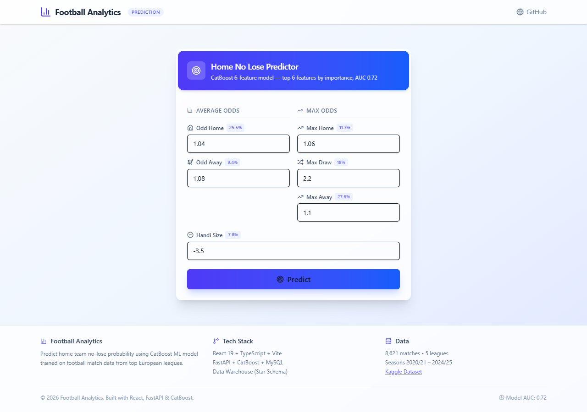
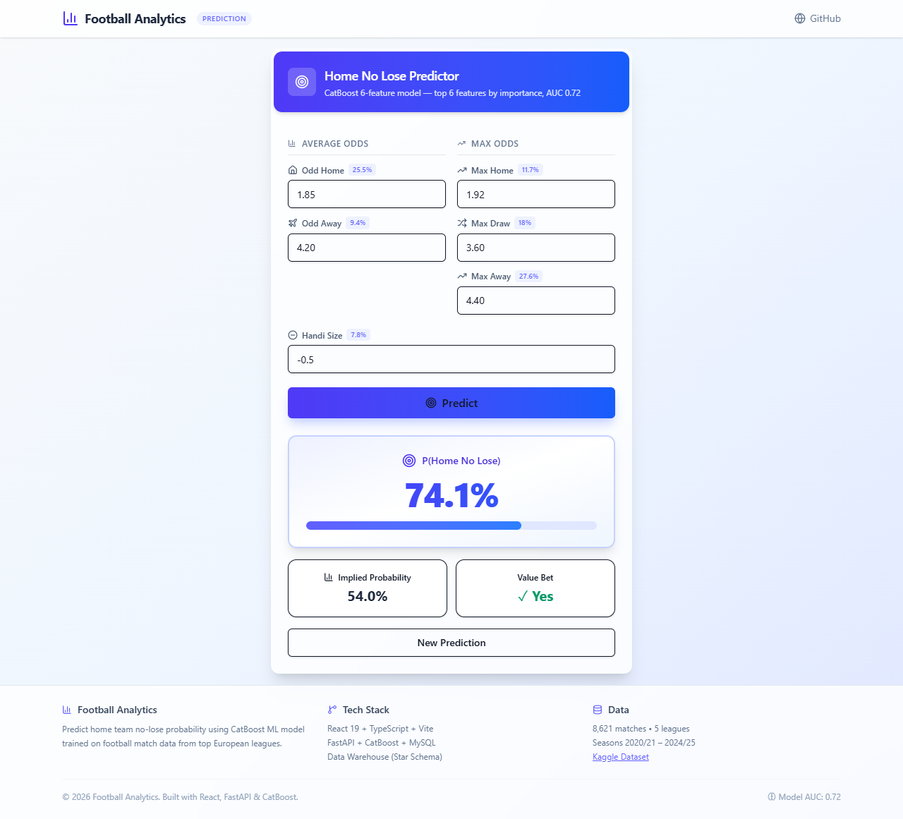
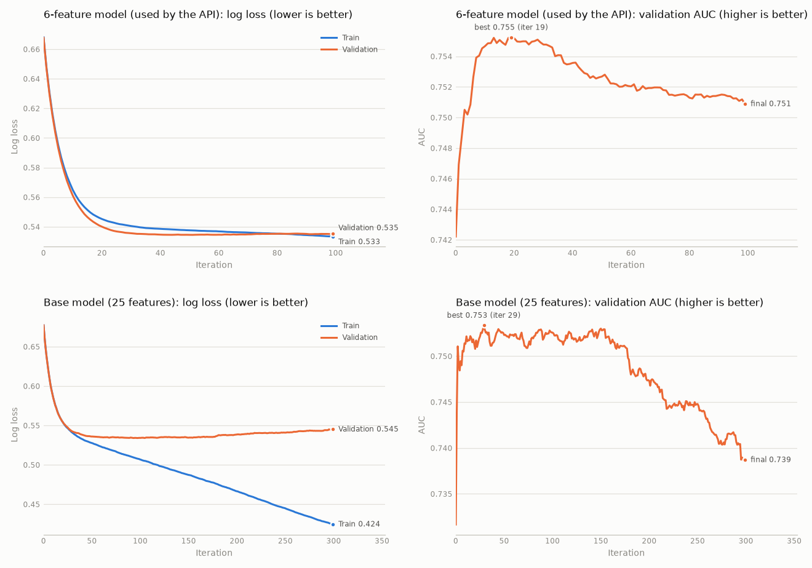

# Football Analytics


A data warehouse of football matches from five top European leagues, fed by an ETL pipeline from raw CSV files into a MySQL database, together with a statistical analysis of the loaded data and CatBoost models that predict whether the home team avoids defeat.

## Preview

Charts generated from the data in the warehouse (8,621 matches from the 2020/21–2024/25 seasons).


| Elo rating distribution by league | Shots on target vs goals |
|---|---|
|  |  |

### Prediction app

The web app sends bookmaker odds and the Asian Handicap to the API, which returns the 6-feature model's probability that the home team does not lose. It compares that with the probability implied by the home odds and flags a value bet when the model's is higher.

| Before: the form opens with each field at its minimum allowed value | After: odds entered (home 1.85, away 4.20, handicap −0.5) and prediction returned |
|---|---|
|  |  |

The API is documented in [docs/API.md](docs/API.md), covering its endpoints, request and response fields, and Python functions. With the API running, interactive Swagger docs are at `http://localhost:8080/docs`; a standalone copy is in [docs/api/index.html](docs/api/index.html).

## Dataset

The project uses the **[Club Football Match Data (2000–2025)](https://www.kaggle.com/datasets/adamgbor/club-football-match-data-2000-2025)** dataset by Adam Gábor (MIT license). The warehouse holds matches from the I1 (Serie A), SP1 (La Liga), D1 (Bundesliga), F1 (Ligue 1) and N1 (Eredivisie) leagues played between 1 August 2020 and 30 June 2025.

## ETL pipeline

1. **Extract** — loads the CSV files into the `raw_eloRatings` and `raw_Matches` tables.
2. **Clean** — converts types and fills in missing or invalid values.
3. **Load** — loads 5 dimension tables and the `fact_matches` fact table in a star schema.
4. **Export** — saves the raw data to `backend/csv/raw/` and the dimensions to `backend/csv/clean/`.

| Table | Contents |
|---|---|
| `dim_country` | Countries |
| `dim_division` | Leagues |
| `dim_team` | Teams and their current Elo rating |
| `dim_season` | Seasons |
| `dim_date` | Calendar |
| `fact_matches` | Results, match statistics, Elo ratings and bookmaker odds |

## Statistical analysis

The analysis reads from the `v_matches_enriched` view, which joins the fact table with its dimensions.

- **Descriptive statistics** — minimum, maximum, mean, standard deviation, median and quantiles.
- **Relationships** — Pearson correlation between the half-time and full-time result, linear regression of shots on target and goals, and a correlation matrix saved to `correlation_matrix.xlsx`.
- **Bookmaker odds** — odds distribution, implied probability and bookmaker margin.
- **9 charts** — number of teams per league, cards, Elo rating over time and by league, goal distributions, fouls, and goals versus shots on target.

## Machine learning models

Three CatBoost classifiers predict **HomeNoLose**: whether the home team does not lose (home win or draw = 1, away win = 0). The pipeline reads from the `v_matches_ml` view.

| Model | File | Features | CV AUC | Test AUC | Test accuracy | Test F1 |
|---|---|---|---|---|---|---|
| Base | `catboost_base.cbm` | 25: all numerical features (Elo, form, 1X2 and over/under odds, Asian Handicap and the dataset's `C_*` indicators) | 0.740 | 0.716 | 0.715 | 0.807 |
| 10-feature | `catboost_10feat.cbm` | 10 most important features of the base model | 0.739 | 0.716 | 0.709 | 0.802 |
| 6-feature | `catboost_6feat.cbm` | `OddHome`, `OddAway`, `MaxAway`, `HandiSize`, `MaxHome`, `MaxDraw` | 0.741 | 0.716 | 0.712 | 0.804 |

- **Data split**: 80% train, 10% validation, 10% test, stratified by the target (`random_state=42`).
- **Training**: grid search over `iterations` (100, 300, 500), `depth` (4–6) and `learning_rate` (0.03, 0.05, 0.1) with 5-fold cross-validation, optimising AUC.
- **Feature selection**: the 10- and 6-feature sets are the top features by importance in the base model. Dropping 19 features barely changes the scores, so the 6-feature model needs only bookmaker odds and the handicap.
- **Outputs**: models are saved in `backend/ml_exploratory_analysis/models/`. Metrics, best hyperparameters and feature importance charts go to `backend/ml_exploratory_analysis/results/`.

The feature lists are defined in `backend/common/constants.py` (`FEATURE_COLS_BASE`, `FEATURE_COLS_10`, `FEATURE_COLS_6`).

### Training curves



- **6-feature model**: train and validation log loss stay together, so the model does not overfit. Validation AUC peaks at 0.755 around iteration 19 and settles at 0.751 after 100 iterations.
- **Base model**: after about 50 iterations, train log loss keeps falling while validation log loss stops improving, and from about iteration 170 it rises. The model is memorising the training data. Validation AUC holds around 0.75 until iteration 150, then drops to 0.739 by iteration 300. Fewer iterations or early stopping would likely help it.

The curves come from CatBoost's training logs in `catboost_info/`. CatBoost writes this folder in the directory the training was started from, and each run overwrites it:

| Folder | Model |
|---|---|
| `backend/catboost_info/` | 6-feature model |
| `backend/ml_exploratory_analysis/catboost_info/` | Base model |

There is no log for the 10-feature model, because a later run overwrote it. Each folder holds per-iteration metrics (`learn_error.tsv`, `test_error.tsv`), the run's settings (`catboost_training.json`) and TensorBoard event files. To redraw the chart after retraining, run `python ml_exploratory_analysis/plot_training_curves.py` from `backend`.

## Requirements

- Python 3.13 or newer
- Docker with Docker Compose (for the MySQL database)
- The dataset files saved as:
  - `backend/csv/raw/raw_Matches.csv` — matches; columns as in the `raw_Matches` table (`backend/database/tables/raw/raw_matches.py`), including the leading `id` column,
  - `backend/csv/raw/raw_eloRatings.csv` — Elo ratings with the `date`, `club`, `country` and `elo` columns.

## Getting started

### 1. Configuration

Clone the repository and create a `.env` file in its root directory:

```bash
git clone https://github.com/tomson218/football-analytics.git
cd football-analytics
```

```env
YOUR_HOST=127.0.0.1
YOUR_PORT=3307
YOUR_USER=root
YOUR_PASSWORD=your_password
YOUR_DB_NAME=football_dw
```

### 2. Database

```bash
docker compose up -d
docker compose ps    # wait until the db service is "healthy"
```

MySQL is available at `127.0.0.1:3307`.

### 3. Python environment

```bash
cd backend
python -m venv venv
source venv/bin/activate      # Windows: venv\Scripts\activate
pip install -r requirements.txt
```

### 4. Data warehouse and ETL

```bash
python database/main_dw_db.py           # schema: tables and views
python database/etl/etl_raw_to_dw.py    # ETL: CSV -> warehouse
```

### 5. Statistical analysis

```bash
python -m statistical_analysis.run_stats              # descriptive statistics and correlation matrix
python -m statistical_analysis.stats.run_odds_stats   # odds analysis
python -m statistical_analysis.visualisation_data     # 9 charts
```

### 6. Machine learning models

```bash
python ml_exploratory_analysis/prepare_data.py      # export v_matches_ml to data/matches_cleaned.csv
python ml_exploratory_analysis/data_processing.py   # build the HomeNoLose target
python ml_exploratory_analysis/train_models.py      # train and save the 3 models
python ml_exploratory_analysis/testing.py           # evaluate the base model on the test set
```

Training runs a grid search for each model, so it takes a few minutes. `testing.py` also saves a confusion matrix and sample predictions to `results/`.

Steps 3–6 can also be run with the scripts in the `backend` directory: `scripts/sh/run_etl.sh`, `scripts/sh/run_stats.sh` and `scripts/sh/run_ml.sh` (Linux/macOS) or `scripts\bat\run_etl.bat`, `scripts\bat\run_stats.bat` and `scripts\bat\run_ml.bat` (Windows).

## Project structure

```
football-analytics/
├── backend/
│   ├── common/                  # Configuration constants
│   ├── csv/                     # Input files and CSV exports
│   ├── database/
│   │   ├── etl/                 # ETL pipeline
│   │   ├── tables/              # Table definitions
│   │   └── views/               # SQL views
│   ├── ml_exploratory_analysis/
│   │   ├── models/              # Trained CatBoost models (.cbm)
│   │   └── results/             # Metrics and model comparison
│   ├── scripts/                 # Run scripts
│   ├── statistical_analysis/    # Statistics and charts
│   └── requirements.txt
├── docs/images/                 # Chart screenshots for the README
├── docker-compose.yaml
├── LICENSE
└── README.md
```

## License

The code is released under the [MIT](LICENSE) license. The [Club Football Match Data (2000–2025)](https://www.kaggle.com/datasets/adamgbor/club-football-match-data-2000-2025) dataset is the work of Adam Gábor and is also released under the MIT license.
