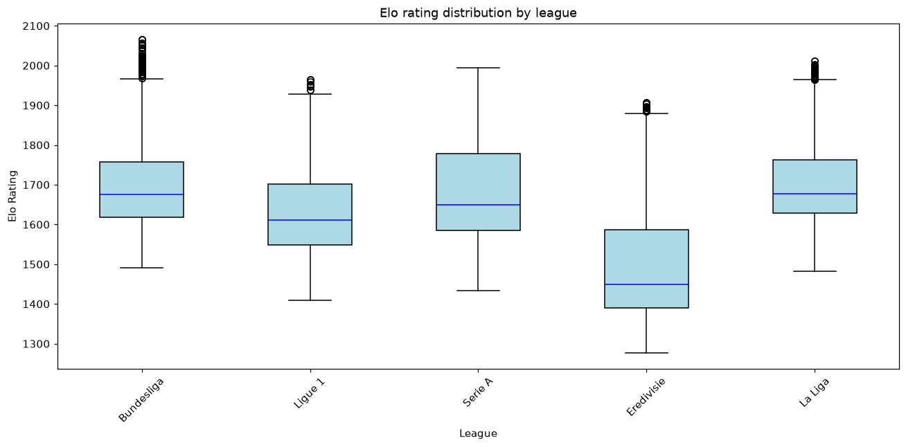

# Football Analytics


A data warehouse of football matches from five top European leagues, fed by an ETL pipeline from raw CSV files into a MySQL database, together with a statistical analysis of the loaded data.

## Preview

Charts generated from the data in the warehouse (8,621 matches from the 2020/21–2024/25 seasons).


| Elo rating distribution by league | Shots on target vs goals |
|---|---|
|  |  |

## Dataset

The project uses the **[Club Football Match Data (2000–2025)](https://www.kaggle.com/datasets/adamgbor/club-football-match-data-2000-2025)** dataset by Adam Gábor (MIT license). The warehouse holds matches from the I1 (Serie A), SP1 (La Liga), D1 (Bundesliga), F1 (Ligue 1) and N1 (Eredivisie) leagues played between 1 August 2020 and 30 June 2025.

## ETL pipeline

1. **Extract** — loads the CSV files into the `raw_eloRatings` and `raw_Matches` tables.
2. **Clean** — converts types and fills in missing or invalid values.
3. **Load** — loads 5 dimension tables and the `fact_matches` fact table in a star schema.
4. **Export** — saves the raw data to `backend/csv/raw/` and the dimensions to `backend/csv/clean/`.

| Table | Contents |
|---|---|
| `dim_country` | Countries |
| `dim_division` | Leagues |
| `dim_team` | Teams and their current Elo rating |
| `dim_season` | Seasons |
| `dim_date` | Calendar |
| `fact_matches` | Results, match statistics, Elo ratings and bookmaker odds |

## Statistical analysis

The analysis reads from the `v_matches_enriched` view, which joins the fact table with its dimensions.

- **Descriptive statistics** — minimum, maximum, mean, standard deviation, median and quantiles.
- **Relationships** — Pearson correlation between the half-time and full-time result, linear regression of shots on target and goals, and a correlation matrix saved to `correlation_matrix.xlsx`.
- **Bookmaker odds** — odds distribution, implied probability and bookmaker margin.
- **9 charts** — number of teams per league, cards, Elo rating over time and by league, goal distributions, fouls, and goals versus shots on target.

## Requirements

- Python 3.13 or newer
- Docker with Docker Compose (for the MySQL database)
- The dataset files saved as:
  - `backend/csv/raw/raw_Matches.csv` — matches; columns as in the `raw_Matches` table (`backend/database/tables/raw/raw_matches.py`), including the leading `id` column,
  - `backend/csv/raw/raw_eloRatings.csv` — Elo ratings with the `date`, `club`, `country` and `elo` columns.

## Getting started

### 1. Configuration

Clone the repository and create a `.env` file in its root directory:

```bash
git clone https://github.com/tomson218/football-analytics.git
cd football-analytics
```

```env
YOUR_HOST=127.0.0.1
YOUR_PORT=3307
YOUR_USER=root
YOUR_PASSWORD=your_password
YOUR_DB_NAME=football_dw
```

### 2. Database

```bash
docker compose up -d
docker compose ps    # wait until the db service is "healthy"
```

MySQL is available at `127.0.0.1:3307`.

### 3. Python environment

```bash
cd backend
python -m venv venv
source venv/bin/activate      # Windows: venv\Scripts\activate
pip install -r requirements.txt
```

### 4. Data warehouse and ETL

```bash
python database/main_dw_db.py           # schema: tables and view
python database/etl/etl_raw_to_dw.py    # ETL: CSV -> warehouse
```

### 5. Statistical analysis

```bash
python -m statistical_analysis.run_stats              # descriptive statistics and correlation matrix
python -m statistical_analysis.stats.run_odds_stats   # odds analysis
python -m statistical_analysis.visualisation_data     # 9 charts
```

Steps 3–5 can also be run with the scripts in the `backend` directory: `scripts/sh/run_etl.sh` and `scripts/sh/run_stats.sh` (Linux/macOS) or `scripts\bat\run_etl.bat` and `scripts\bat\run_stats.bat` (Windows).

## Project structure

```
football-analytics/
├── backend/
│   ├── common/                  # Configuration constants
│   ├── csv/                     # Input files and CSV exports
│   ├── database/
│   │   ├── etl/                 # ETL pipeline
│   │   ├── tables/              # Table definitions
│   │   └── views/               # SQL views
│   ├── scripts/                 # Run scripts
│   ├── statistical_analysis/    # Statistics and charts
│   └── requirements.txt
├── docs/images/                 # Chart screenshots for the README
├── docker-compose.yaml
├── LICENSE
└── README.md
```

## License

The code is released under the [MIT](LICENSE) license. The [Club Football Match Data (2000–2025)](https://www.kaggle.com/datasets/adamgbor/club-football-match-data-2000-2025) dataset is the work of Adam Gábor and is also released under the MIT license.
